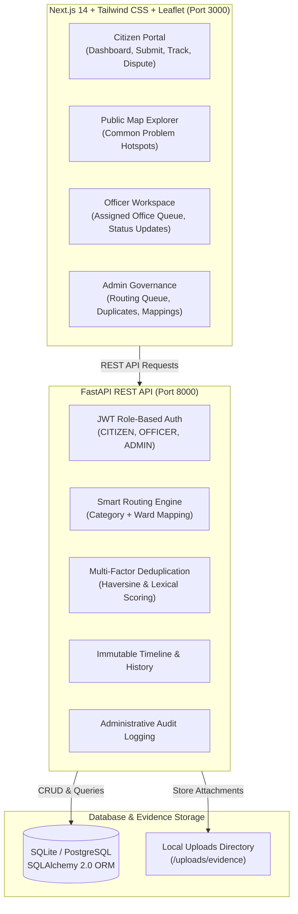

# Jan Seva (जन सेवा)
### Citizen Problem Reporting, Smart Routing & Resolution Platform for India

> [!NOTE]
> **Independent Prototype & Demonstration Disclosure**:  
> Jan Seva is an independent civic technology prototype and research startup platform. It is **not** officially operated by, endorsed by, or affiliated with the Government of India or any official municipal corporation. All municipal bodies (e.g. *Mayanagari Municipal Corporation*), departments, officer accounts, and authority assignments are simulated demonstration entities.

---

## 1. Product Overview

**Jan Seva** empowers Indian citizens to report local civic infrastructure and public service grievances—such as damaged roads, broken streetlights, water supply interruptions, sewage overflow, and garbage collection failures—while intelligently routing each report to the exact responsible department and office.

### Key Innovations:
1. **Deduplication without Data Loss (Common Problem Grouping)**:  
   When dozens of citizens report the same road pothole or overflowing drain, Jan Seva does **not** merge or delete their individual complaints. Instead, it aggregates them into a shared public **Common Problem Hotspot**, preserving every citizen's individual tracking number, status history, and dispute rights.
2. **Deterministic Smart Routing Engine**:  
   Evaluates issue categories against geographic jurisdiction boundaries (Wards, Municipal Zones). Ambiguous or boundary-straddling complaints are placed into a human-in-the-loop **Uncertain Routing Queue** for platform administrator reassignment.
3. **Immutable Chronological Timelines**:  
   Every state change, officer dispatch note, and evidence photo is permanently recorded with timestamps, transparently distinguishing simulated platform events from verified external actions.
4. **Citizen Privacy by Default**:  
   Public problem pages display generalized neighborhood names and rounded map coordinates. Individual citizen names, phone numbers, and exact residential addresses are strictly protected.
5. **Bilingual Accessibility (English & Hindi)**:  
   Full interface localization tailored for Indian citizens.

---

## 2. System Architecture



---

## 3. Pre-configured Demo Accounts

Use these fictional accounts to immediately test and evaluate all user roles:

| Role | Email Address | Password | Assigned Authority & Scope |
| :--- | :--- | :--- | :--- |
| **Citizen** | `rajesh@example.com` | `demo12345` | Citizen Dashboard, submit & track complaints |
| **Citizen 2** | `priya@example.com` | `demo12345` | Submits nearby reports (triggers hotspot grouping) |
| **Authority Officer (PWD)** | `officer.pwd@mayanagari.gov.demo` | `demo12345` | PWD Zone 1 (Roads, Bridges, Potholes) |
| **Authority Officer (Waste)** | `officer.waste@mayanagari.gov.demo` | `demo12345` | SWM Central Office (Garbage & Sanitation) |
| **Platform Administrator** | `admin@janseva.org.demo` | `demo12345` | Full routing, duplicate review & audit control |

*(You can also use the **Quick Demo Login buttons** directly on the `/login` page).*

---

## 4. Quick Start & Local Execution

### Prerequisites
- **Python**: 3.11 or 3.12 (A dedicated CPython 3.12 virtual environment is pre-configured at `backend/.venv`)
- **Node.js**: v18.0.0 or higher with `npm`

---

### Step 1: Run the Backend (FastAPI)

1. Open a terminal in the project root:
   ```powershell
   cd backend
   ```
2. Activate the virtual environment:
   - **Windows PowerShell**:
     ```powershell
     .\.venv\Scripts\Activate.ps1
     ```
   - **Linux / macOS**:
     ```bash
     source .venv/bin/activate
     ```
3. *(Optional)* Seed or re-seed sample demonstration data:
   ```bash
   python app/seed.py
   ```
4. Start the FastAPI development server:
   ```bash
   uvicorn app.main:app --reload --port 8000
   ```
5. The API is now live at `http://127.0.0.1:8000`.
   - Interactive Swagger API Documentation: `http://127.0.0.1:8000/docs`
   - ReDoc Documentation: `http://127.0.0.1:8000/redoc`

---

### Step 2: Run the Frontend (Next.js)

1. Open a second terminal in the project root:
   ```powershell
   cd frontend
   ```
2. Start the development server:
   ```bash
   npm run dev
   ```
3. Open your browser and navigate to:
   ```
   http://localhost:3000
   ```

---

## 5. Automated Test Suite

Jan Seva includes an extensive automated test suite covering authentication, role isolation, complaint routing, duplicate detection, officer permissions, citizen dispute flows, and privacy leak prevention.

Run all tests via pytest:
```powershell
$env:PYTHONPATH = "backend"
.\backend\.venv\Scripts\python.exe -m pytest backend/tests -v
```

### Verified Test Cases:
- `test_valid_citizen_registration`: Verifies user registration and prevents automatic privilege escalation.
- `test_citizen_cannot_self_assign_privileged_role`: Rejects attempts to assign `AUTHORITY_OFFICER` or `PLATFORM_ADMIN` during registration.
- `test_duplicate_registration_fails`: Ensures unique email addresses.
- `test_valid_login` & `test_invalid_login`: Validates bcrypt hashing and JWT token issuance.
- `test_unauthorized_protected_endpoint`: Enforces token requirements on secure endpoints.
- `test_submit_complaint_with_auto_routing`: Validates full submission flow, geo-pinning, and smart authority assignment.
- `test_citizen_access_isolation`: Ensures citizens cannot view or manipulate other citizens' private complaint records.
- `test_citizen_dispute_flow`: Validates dispute and reopen capability when resolution is disputed.
- `test_officer_assigned_records_and_boundary_isolation`: Proves officers can only access complaints within their assigned office jurisdiction.
- `test_officer_status_update_and_timeline`: Validates status updates, action notes, resolution evidence, and timeline entries.
- `test_public_privacy_leak_prevention`: Asserts that public common problem endpoints never expose citizen names, phone numbers, or residential addresses.
- `test_deduplication_and_common_problem_grouping`: Verifies that nearby similar complaints automatically cluster into a Common Problem without losing individual records.
- `test_distinct_issue_in_same_ward_remains_separate`: Verifies that different categories or distant reports in the same ward remain distinct.
- `test_uncertain_routing_and_admin_reassignment`: Verifies placement of ambiguous complaints into review queue and administrative reassignment.
- `test_admin_reference_data_and_mappings`: Validates administrator management of departments, offices, and jurisdictional routing rules.

---

## 6. Core Algorithms & Logic

### A. Deduplication & Grouping Heuristics
When a complaint is submitted, it is compared against active open issues in the same category:
$$\text{Score} = (0.55 \times S_{\text{geo}}) + (0.35 \times S_{\text{lex}}) + (0.10 \times S_{\text{rec}})$$

- **Geographic Proximity ($S_{\text{geo}}$)**: Calculated using the Haversine formula. 
  - Distance $\le 50\text{m} \implies 1.0$
  - Decays linearly up to $350\text{m}$.
  - Distance $> 350\text{m} \implies 0.0$
- **Lexical Overlap ($S_{\text{lex}}$)**: Jaccard similarity across normalized, stopword-filtered keyword tokens.
- **Recency Decay ($S_{\text{rec}}$)**: $\le 14\text{ days} \implies 1.0$; $\le 45\text{ days} \implies 0.7$; $> 45\text{ days} \implies 0.3$.

**Threshold Decisions**:
- **$\text{Score} \ge 0.70$**: Automatically linked to existing Common Problem (increments citizen report counter).
- **$0.40 \le \text{Score} < 0.70$**: Sent to Administrator **Duplicate Review Queue** with side-by-side comparison.
- **$\text{Score} < 0.40$**: Creates a new distinct Common Problem.

### B. Smart Authority Routing Engine
1. Validates complaint category and geographic area (Ward / Zone).
2. Searches active `AuthorityMapping` rules for `(category_id, geographic_area_id)`.
3. If matched, sets status to `ASSIGNED_PROTOTYPE` and links responsible `Department` and `Office`.
4. If area is unmapped or ambiguous, assigns `RoutingStatus.UNCERTAIN` and routes to the administrator's **Uncertain Routing Queue**.

---

## 7. Project Structure

```
jan-seva-2/
├── backend/
│   ├── app/
│   │   ├── api/v1/          # Modular API endpoints (auth, complaints, officer, admin, etc.)
│   │   ├── core/            # Configuration, database engine, security, dependencies
│   │   ├── models/          # SQLAlchemy ORM models (User, Complaint, CommonProblem, etc.)
│   │   ├── schemas/         # Pydantic v2 validation schemas
│   │   ├── services/        # Routing engine, deduplication detector, timeline, notifications
│   │   ├── main.py          # FastAPI application entrypoint
│   │   └── seed.py          # Demonstration database populator
│   ├── tests/               # Pytest automated test suite (16 comprehensive tests)
│   ├── uploads/             # Citizen evidence and officer resolution photo store
│   └── requirements.txt     # Pinned Python package dependencies
├── frontend/
│   ├── src/
│   │   ├── app/             # Next.js 14 App Router pages
│   │   │   ├── page.tsx               # Landing page with metrics & how-it-works
│   │   │   ├── login/page.tsx         # Login with 1-click demo role accounts
│   │   │   ├── register/page.tsx      # Citizen registration
│   │   │   ├── dashboard/page.tsx     # Citizen dashboard with counters & recent reports
│   │   │   ├── submit/page.tsx        # Complaint submission with Leaflet pin-drop
│   │   │   ├── complaints/page.tsx    # "My Complaints" filterable directory
│   │   │   ├── complaints/[id]/       # Complaint tracking & dispute timeline
│   │   │   ├── common-problems/       # Public Common Problems map & cards
│   │   │   ├── common-problems/[id]/  # Public Hotspot detail (privacy protected)
│   │   │   ├── officer/page.tsx       # Authority Officer workspace & status updater
│   │   │   ├── admin/page.tsx         # Platform Administrator queue & rules manager
│   │   │   ├── profile/page.tsx       # User profile, role badges & settings
│   │   │   └── faq/page.tsx           # Knowledge base & FAQs
│   │   ├── components/      # UI components (LeafletMap, StatusBadge, TimelineView, etc.)
│   │   └── lib/             # API client (api.ts) and bilingual dictionary (i18n.tsx)
│   ├── tailwind.config.js   # Tailwind CSS configuration
│   ├── next.config.js       # Next.js configuration with proxy rewrites
│   └── package.json         # Node.js dependencies
├── jan_seva.db              # SQLite development database
├── implementation_plan.md   # Architectural blueprint & specification
└── README.md                # This comprehensive documentation
```

---

## 8. License & Prototype Notice

Distributed for evaluation, testing, and research demonstration. Not intended for direct submission to real government grievance systems without verified and officially approved departmental integrations.
